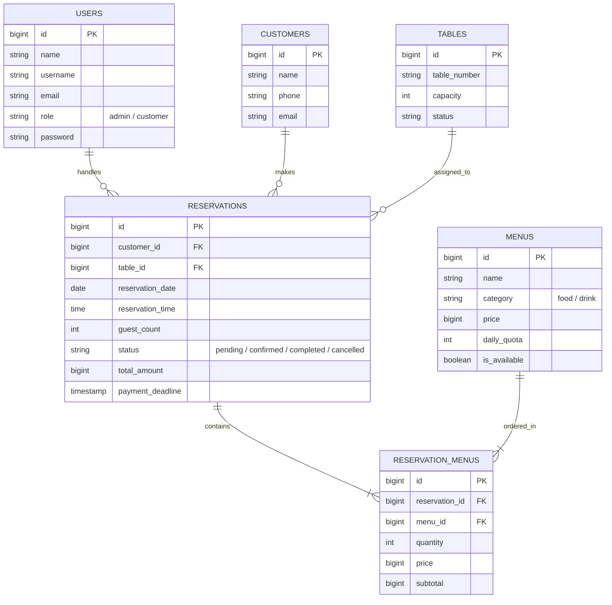

# RestoUs — Sistem Informasi Reservasi Meja & Pemesanan Menu Restoran

<p align="center">
  
</p>

<p align="center">
  
  
  
  
  
  
</p>

---

## 📌 Tentang RestoUs

**RestoUs** adalah aplikasi berbasis web yang dirancang untuk mengatasi permasalahan antrean fisik, tabrakan pemakaian meja makan, dan ketidakpastian stok bahan baku pada restoran. 

Aplikasi ini dibangun sebagai **portofolio resmi Asesmen Sertifikasi Kompetensi BNSP (Badan Nasional Sertifikasi Profesi) Skema Pemrogram (Programmer)** oleh asesi **Reza**, mengacu pada dokumen spesifikasi formal **[SKPL-RestoUs-01.md](SKPL-RestoUs-01.md)** (mengadopsi standar *IEEE Std 830-1998*) dan Standar Kompetensi Kerja Nasional Indonesia (**SKKNI**).

---

## 🏆 4 Aturan Emas Bisnis (*Core Business Rules*)

RestoUs menerapkan 4 pilar logika bisnis utama yang tervalidasi secara otomatis oleh sistem:

1. 📅 **Minimal Reservasi H-1 (`SKPL-R-05`)**  
   Pelanggan tidak dapat memesan meja di hari H atau tanggal lampau guna memberikan waktu persiapan bahan baku segar bagi dapur restoran. Jam kedatangan dibatasi pada rentang operasional **10:00 s/d 19:00 WIB**.
2. ⏱️ **Durasi Santap Maksimal 2 Jam (`SKPL-R-06`)**  
   Mencegah tabrakan pemesanan meja (*anti-double booking*). Sistem menjalankan algoritma persinggungan interval waktu untuk menonaktifkan (*disabled*) meja yang telah dipesan pada rentang $\pm 2\text{ jam}$ bersinggungan.
3. 🍲 **Batas Kuota Harian 50 Porsi/Menu (`SKPL-R-07`)**  
   Setiap hidangan dibatasi maksimal 50 porsi per hari untuk menjamin kualitas kesegaran makanan. Sisa kuota dihitung dinamis berdasarkan pesanan aktif pada tanggal tersebut.
4. ⏳ **Auto-Cancel 1 Jam & Direct WhatsApp (`SKPL-R-08` & `SKPL-R-09`)**  
   Pesanan baru berstatus `Pending` dengan tenggat waktu pembayaran **60 menit**. Jika melewati batas tanpa verifikasi admin, sistem otomatis mengubah status menjadi `Cancelled` untuk melepaskan meja kembali bagi pelanggan lain. Konfirmasi pembayaran diarahkan langsung ke WhatsApp resmi **0822-5478-1995**.

---

## 🚀 Fitur Utama Sistem

### 👤 Portal Pelanggan (*Customer*)
* **Landing Page & Tata Tertib**: Halaman pengenalan restoran dan transparansi 5 tata tertib operasional (`/rules`).
* **Katalog Menu & Sisa Kuota Dinamis**: Daftar makanan dan minuman lengkap dengan penanda kuota porsi harian berbasis tanggal terpilih.
* **Pemesanan Meja Real-time**: Formulir booking dengan pengecekan ketersediaan meja interaktif (AJAX).
* **Invoice & Countdown Pembayaran**: Halaman nota reservasi dengan penghitung mundur batas bayar 1 jam dan generator link Direct WhatsApp dengan draf rincian pesanan siap kirim.
* **Cetak & Unduh Faktur / Invoice PDF (`SKPL-R-11`)**: Unduh salinan faktur resmi berstandar cetak A4 dengan watermark status lunas dan rincian pemesanan.
* **Lacak Riwayat Reservasi**: Pengecekan status booking pelanggan cukup dengan memasukkan nomor telepon.

### 🛡️ Dasbor Super Admin (`/admin`)
* **Proteksi Hak Akses (Middleware)**: Jalur panel admin terproteksi ketat; akses oleh pengguna umum/customer otomatis ditolak.
* **Manajemen Reservasi Transaksional**: Verifikasi bukti bayar WhatsApp, perubahan status (`Pending` $\rightarrow$ `Confirmed` $\rightarrow$ `Completed` $\rightarrow$ `Cancelled`).
* **Manajemen Menu & Kuota Harian**: Pengaturan harga porsi, ketersediaan menu, dan batas porsi per hari.
* **Manajemen Meja Restoran**: Pemantauan kapasitas meja dan ketersediaan meja makan.

---

## 🛠️ Arsitektur & Teknologi (*Tech Stack*)

| Komponen | Teknologi yang Digunakan | Penjelasan |
| :--- | :--- | :--- |
| **Bahasa Pemrograman** | PHP 8.3+ | Mengikuti standar penulisan **PSR-12** (*Clean Code*). |
| **Framework Backend** | Laravel 11 / 13 | Arsitektur **MVC**, Routing, Middleware, Eloquent ORM. |
| **Basis Data** | MySQL 8.0+ | Database Relasional dengan Foreign Key constraint & indexing. |
| **Manipulasi Waktu** | Carbon Library | Penanganan interval durasi 2 jam, batas H-1, dan countdown 1 jam. |
| **Frontend UI** | Blade + Bootstrap 5.3 + Bootstrap Icons | Antarmuka responsif dan estetik tanpa dependensi CSS eksternal berat. |
| **Otomasi Pengujian** | PHPUnit Framework | Pengujian otomatis skenario bisnis via `php artisan test`. |
| **Manajemen Library** | Composer | Pengelolaan dependensi berbasis open-source legal (**MIT License**). |

---

## 📊 Pemetaan 9 Unit Kompetensi Asesmen BNSP

Aplikasi ini memenuhi seluruh elemen kompetensi pada **Skema Pemrogram (Programmer)**:

| Kode Unit | Judul Unit Kompetensi | Bukti Implementasi pada RestoUs |
| :--- | :--- | :--- |
| **J.620100.009.01** | Menggunakan Spesifikasi Program | Dokumen [SKPL-RestoUs-01.md](SKPL-RestoUs-01.md) (Bab 3 Matriks Spesifikasi, Bab 4 ERD). |
| **J.620100.016.01** | Menulis Kode Sesuai Guidelines | Format penamaan PSR-12 (PascalCase Controller, camelCase Method, snake_case DB). |
| **J.620100.017.02** | Pemrograman Terstruktur | Algoritma validasi rentang jam 2 jam di `CustomerReservationController.php:287-316`. |
| **J.620100.018.02** | Pemrograman Berorientasi Objek (OOP) | Enkapsulasi `$fillable`, Inheritance `Model`, Relasi Eloquent `Reservation.php`. |
| **J.620100.019.02** | Komponen Pre-existing / Library | Integrasi library Carbon, Laravel Framework, Bootstrap 5.3 via `composer.json`. |
| **J.620100.021.02** | Menerapkan Akses Basis Data | Relasi Foreign Key Parent-Child (`reservations` & `reservation_menus`), Eager Loading `with()`. |
| **J.620100.023.02** | Membuat Dokumentasi Kode Program | Standar blok komentar **PHPDoc** (`@param`, `@return`) & dokumen [SKPL-RestoUs-01.md](SKPL-RestoUs-01.md). |
| **J.620100.025.02** | Melakukan Debugging | Penelusuran stack trace di `storage/logs/laravel.log`, fungsi `dd()`, dan status code HTTP. |
| **J.620100.033.02** | Melaksanakan Pengujian Unit | Skrip pengujian otomatis di `tests/Feature/ExampleTest.php` (Status: PASS). |

---

## 🗄️ Struktur Basis Data Relasional



---

## 💻 Panduan Instalasi & Menjalankan Sistem

### 1. Prasyarat Sistem
* PHP $\ge$ 8.3 dengan ekstensi: `pdo_mysql`, `mbstring`, `openssl`, `tokenizer`, `xml`, `ctype`, `json`.
* Composer $\ge$ 2.5
* MySQL Database $\ge$ 8.0 (XAMPP / Laragon / MySQL Service)

### 2. Langkah Instalasi
1. **Clone atau Buka Direktori Proyek**:
   ```bash
   cd "c:\DataD\New kuliah\sertifikasi bnsp\restous-app"
   ```
2. **Install Dependensi Composer**:
   ```bash
   composer install
   ```
3. **Konfigurasi Environment**:
   Salin file `.env.example` menjadi `.env` (bila belum ada) dan sesuaikan kredensial basis data:
   ```env
   DB_CONNECTION=mysql
   DB_HOST=127.0.0.1
   DB_PORT=3306
   DB_DATABASE=restous_db
   DB_USERNAME=root
   DB_PASSWORD=
   ```
4. **Generate Application Key**:
   ```bash
   php artisan key:generate
   ```
5. **Jalankan Migrasi & Seeder Basis Data**:
   ```bash
   php artisan migrate:fresh --seed
   ```
6. **Jalankan Server Lokal**:
   ```bash
   php artisan serve
   ```
   Aplikasi dapat diakses melalui peramban web pada: **`http://127.0.0.1:8000`**

---

## 🔑 Kredensial Akun Pengujian / Asesmen

| Peran Akun | Username / Email | Password | Hak Akses Utama |
| :--- | :--- | :--- | :--- |
| **Super Admin** | `admin` | `admin123` | Akses penuh dashboard kelola reservasi, menu, meja (`/admin`). |
| **Customer Demo** | `customer` | `password123` | Akses pemesanan meja dan pengecekan invoice. |
| **WhatsApp Admin** | `0822-5478-1995` | - | Saluran resmi verifikasi transfer manual. |

---

## 🧪 Pengujian Otomatis (*Unit & Feature Testing*)

Untuk memverifikasi keutuhan logika aplikasi dan proteksi rute di hadapan Asesor, jalankan perintah:

```bash
php artisan test
```

### Hasil Verifikasi:
```text
   PASS  Tests\Feature\ExampleTest
  ✓ public pages are accessible                                 0.15s  
  ✓ guest cannot access admin panel                             0.05s  
  ✓ customer cannot access admin panel                          0.04s  
  ✓ admin can login with username and password                  0.08s  
  ✓ customer can register new account                           0.06s  
  ✓ customer can login with google demo                         0.04s  
  ✓ authenticated customer can book table                       0.09s  

  Tests:    8 passed (34 assertions)
  Duration: 1.10s
```

---

## 📚 Dokumen Terkait
* 📄 **[SKPL-RestoUs-01.md](SKPL-RestoUs-01.md)**: Dokumen Spesifikasi Kebutuhan Perangkat Lunak Resmi (IEEE Std 830-1998).
* 📄 **[PANDUAN-ASESMEN-BNSP-RESTOUS.md](PANDUAN-ASESMEN-BNSP-RESTOUS.md)**: Panduan Teknis & Kisi-kisi Wawancara Asesor BNSP (9 Unit Kompetensi).

---

## 📄 Lisensi
Aplikasi ini dilisensikan di bawah **[MIT License](LICENSE)** — Terbuka, aman, dan mematuhi kaidah penggunaan library pre-existing.
